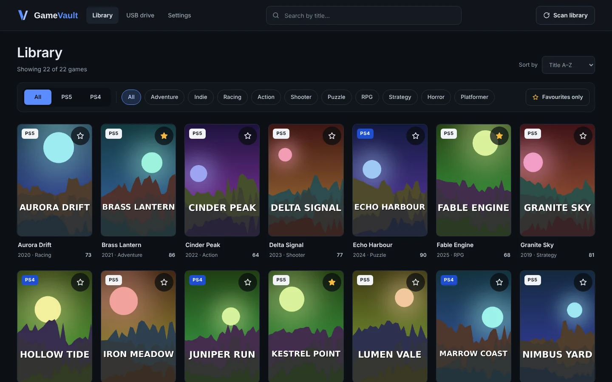
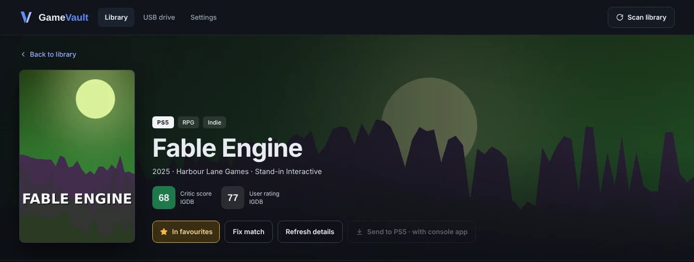
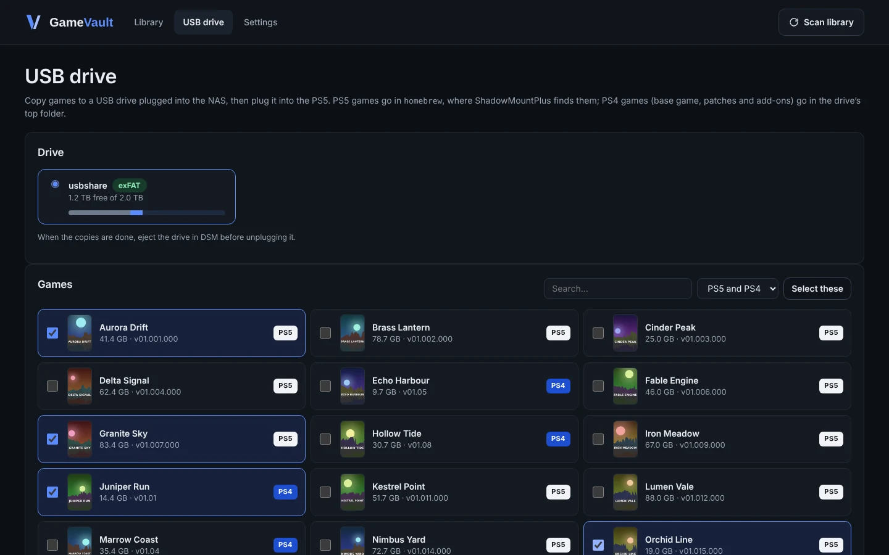
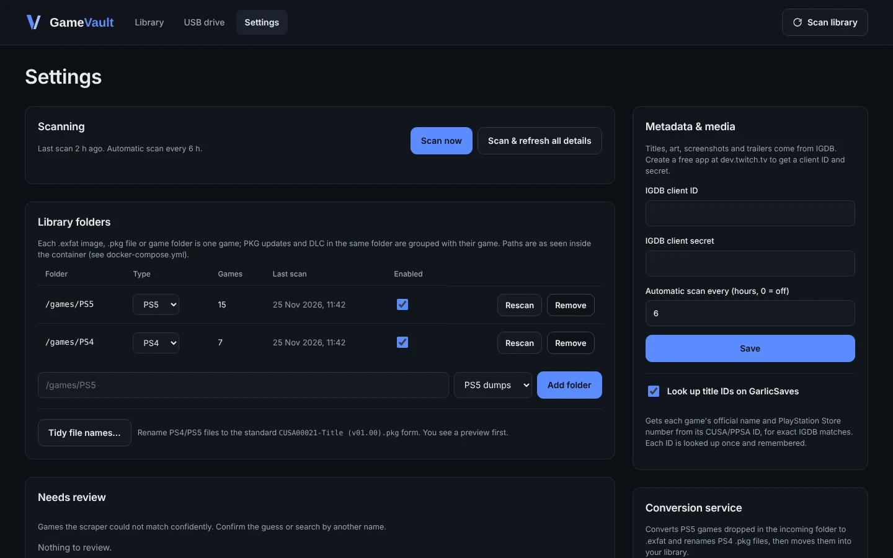

<p align="center"></p>

# GameVault

A self-hosted catalogue for PlayStation game dumps, served as a web page from your NAS. It works like Ember Media Manager does for movies.

- Scans **PS5 `.exfat` game images**, **PS4 `.pkg`** files (base game + updates + DLC grouped per folder) and unpacked PS4/PS5 folder dumps
- Reads title, title ID, content ID and version straight from the dumps (including from inside `.exfat` images, without mounting them), plus their own icon
- Looks every game up on **IGDB**: poster, backdrop, screenshots, trailer, summary, release year, genres, developer and publisher, critic and user scores
- Library page with PS5/PS4 filter, categories, title search, favourites and sorting
- Details page with the scraped info plus size, file count, dates and path
- **REST API** (`/api/v1`) for everything, including file listing and HTTP Range downloads, ready for a PS5 client app
- Optional **conversion service**: drop a PS5 game in a folder and it becomes a correctly named `.exfat` in your library; drop a PS4 `.pkg` and it is renamed from its own header and filed
- One Docker container; runs on Synology, or any Linux box with Docker (amd64 and arm64)

## Screenshots

<sub>Made-up games with generated artwork, for illustration.</sub>

**Library**: every PS5 and PS4 game on the NAS, with filters, categories, search and favourites.



**Game page**: artwork, details and scores from IGDB, with file information below.



| USB drive: copy games to a drive plugged into the NAS | Settings: libraries, scanning, IGDB and the conversion service |
|---|---|
|  |  |

The PS5 side, with its home-screen app, is [GameVault for PS5](https://github.com/CNBailey/gamevault-client).

GameVault's database and artwork live in `/data`. The `Games` share is mounted read-write so the conversion service and **Tidy file names** can file games; nothing in your library is changed unless you use one of those.

## Install on a Synology

1. In **Package Center**, install **Container Manager**.
2. In **File Station**, create the folder `docker/gamevault`.
3. In **Container Manager → Project → Create**: name it `gamevault`, choose the path `/volume1/docker/gamevault`, pick **Create docker-compose.yml**, and paste in [`docker-compose.yml`](docker-compose.yml). It mounts the whole `/volume1/Games` share, with libraries in `Games/PS5` and `Games/PS4`; change the paths if yours differ.
4. Open `http://<nas-ip>:8686`, then go to **Settings → Metadata & media** and enter your IGDB client ID and secret (see below). Click **Scan & refresh all details**.

**Updates** are automatic: the compose file includes a small updater ([nickfedor/watchtower](https://github.com/nicholas-fedor/watchtower), a maintained fork of Watchtower) that checks for a new GameVault image every night at 04:00 and restarts GameVault with it. It only touches containers labelled `com.centurylinklabs.watchtower.enable`. It needs access to the Docker socket to do this; delete the `updater` block if you would rather update by hand (**Project → gamevault → Action → Stop → Clean**, delete the image, then **Build**).

### Getting IGDB credentials (free)
1. Sign in at <https://dev.twitch.tv/console> (a Twitch account is needed; turn on two-factor authentication if asked).
2. **Register Your Application**: any name, OAuth redirect URL `http://localhost`, category *Application Integration*, client type *Confidential*.
3. Copy the **Client ID**, then **New Secret** → copy the secret. Paste both into GameVault's Settings page.

## How games are found

Each library folder is searched up to 4 levels deep. A game is:

| On disk | Detected as |
|---|---|
| `PPSA12345-Name (v01.000.000).exfat` | PS5 exFAT image; details read from `sce_sys/param.json` inside the image, falling back to the file name |
| `Some Game/sce_sys/param.json` | PS5 folder dump |
| `Some Game/sce_sys/param.sfo` | PS4 folder dump |
| `Some Game/*.pkg` (any `.pkg` up to 2 levels inside) | PS4 PKG game; the base game, updates and DLC are grouped together |
| `Some Game.pkg` loose in the library folder | PS4 PKG game |

PS4 patches (a `.pkg` or folder whose name ends in `patch`, or PKGs that are all updates) are attached to their game by title ID or name: they are listed on the game's details page and offered for download with it, but don't appear as games. Patches with no matching game are listed under **Settings → Scanning**.

Synology's `@eaDir` and `#recycle` folders are ignored. If a game disappears from disk it is flagged rather than deleted, so its favourite survives; **Settings → Needs review** lets you clean these up.

Matching, in order:

1. **A match you fixed by hand** before, remembered by title ID (CUSA…/PPSA…) and reused when that game is re-dumped, updated, renamed or converted.
2. **Exact match via [GarlicSaves](https://garlicsaves.com/tools/title-lookup)** (on by default; switch it off in Settings → Metadata & media). The title ID gives the official name and the PlayStation Store concept number, which IGDB stores too. Each ID is looked up once and cached, at most one request per second.
3. **Name search** on IGDB, using the official name from GarlicSaves when there is one (else the title inside the dump, else the file name), with ®/™ symbols, `(PS5)` tags and edition words cleaned out.
4. **Fix match** by hand.

**Homebrew apps** (title IDs in the `PPSA99xxx`/`CUSA99xxx` range or outside CUSA/PPSA, or PS5 titles marked as applications) are not looked up and stay out of Needs review. The library hides them by default; untick **Hide apps**, or pick **Apps** next to All / PS5 / PS4. Uncertain matches appear under **Needs review**. **Fix match** on any game lets you search IGDB yourself.

## Conversion service

Switch it on in **Settings → Conversion service**. A **Conversions** tab then shows what is waiting, running and finished.

| Drop into | What happens |
|---|---|
| `Games/_incoming/PS5` | A game folder (`eboot.bin` + `sce_sys/param.json`), `.ffpkg`, `.ffpfs`, `.ffpfsc`, homebrew `.pkg`, or a `.zip`/`.7z`/`.rar` holding one game is converted to a standard `.exfat` with [PS5 Dump Forge](https://github.com/quer3q/ps5-dump-forge), checked, named `PPSA01417-Title (v01.015.001).exfat` and moved into `Games/PS5`. The original goes to `Games/_incoming/_done`. An `.exfat` is just named and moved in. |
| `Games/_incoming/PS4` | A `.pkg` is renamed from its own header, `CUSA00021-Title (v01.00).pkg` (updates get ` patch`, add-ons ` dlc`), and moved into `Games/PS4`. No conversion. |

- A file is picked up once it has stopped changing for 60 seconds (adjustable), so copies still in progress are never touched. Names ending in `.part`, `.tmp`, `.crdownload` and similar are ignored.
- PS4 and PS5 each run one job at a time, side by side. A job interrupted by a restart starts again automatically; its half-written output is removed.
- Nothing in the library is overwritten: if the name already exists, the job fails and the incoming file stays put. Failed files stay in the incoming folder with the reason shown; fix or replace them, or press **Retry**.
- PS5 names keep within 63 bytes (ShadowMountPlus can't mount longer names): only the title is shortened.
- Before converting, GameVault checks there is enough free space (about 110% of the game).
- `_done` keeps PS5 originals until you delete them from the Conversions page.

**Tidy file names** (Settings → Library folders) renames existing library files to the same standard names, from the details inside each file, with a preview first. Favourites and matches are kept.

PS5 Dump Forge is GPL-3.0; the image bundles its official Linux command-line release (version set in the workflow, `FORGE_VERSION`).

## Copying games to a USB drive

The **USB drive** tab copies games from the library to a USB drive plugged into the NAS, ready to plug into the PS5:

- **PS5 games** go in `homebrew/` on the drive (created if it's missing), where ShadowMountPlus finds them: `.exfat` images as they are, folder dumps as a folder.
- **PS4 games** go in the drive's top folder: the base game `.pkg`, then its patches and add-ons, ready for the console's package installer.
- PS4 folder dumps can't be installed from a USB drive and are refused (make a `.pkg` of them first).

It lists each drive with its format and free space, marks games that are already on the selected drive, and refuses a selection that doesn't fit. Files are written as `name.gvpart` and renamed when complete, so an interrupted copy never looks finished; copying again skips files already there at full size.

GameVault never formats a drive. The PS5 reads games from **exFAT** drives, so GameVault copies only to drives that are exFAT (or whose format DSM hides behind FUSE, with a warning). To format one, in DSM open **Control Panel → External Devices**, select the drive, choose **Format** and pick **exFAT**. Formatting erases the drive. Eject the drive in DSM before unplugging it.

To turn it on, remove the `#` from the two `/volumeUSB` lines in `docker-compose.yml` and **Build** the project again. DSM mounts USB drives at `/volumeUSB1/usbshare`, `/volumeUSB2/usbshare` and so on. The `:rslave` option lets GameVault see a drive plugged in after it started. If Build fails with *not a shared or slave mount*, delete `:rslave` and plug the drive in before starting GameVault.

## API

Base URL: `http://<nas-ip>:8686/api/v1`. All responses are JSON unless noted.

| Method & path | What it does |
|---|---|
| `GET /health` | Version and game count |
| `GET /games?platform=PS5&genre=RPG&q=astro&fav=1&sort=title\|added\|released\|rating\|size&apps=show\|hide\|only` | List games (default: title order, apps included; each has `isApp`) |
| `GET /games/{id}` | Full details |
| `PUT /games/{id}/favourite` `{"favourite": true}` | Set favourite (no body = toggle) |
| `GET /games/{id}/files` | Files making up the game, with sizes and download URLs |
| `GET /games/{id}/files/{path}` | Download a file; supports `Range` for resumable and parallel downloads |
| `POST /games/{id}/rescrape` | Look the game up again |
| `GET /games/{id}/candidates?q=` · `POST /games/{id}/match` `{"igdbId": 123}` | Manual matching |
| `GET /genres` | Categories with counts |
| `GET /scan` · `POST /scan` `{"libraryId"?, "rescrapeAll"?}` | Scan status / start a scan |
| `GET/POST/PATCH/DELETE /libraries` | Library folders |
| `GET /review` | Games needing a manual check |
| `GET/PUT /settings` | IGDB credentials, scan interval |
| `GET /conversions` · `PUT /conversions/settings` `{"enabled", "settleSeconds"}` | Conversion status and switch |
| `POST /conversions/{id}/cancel` · `/retry` · `DELETE /conversions/{id}` | Manage jobs |
| `GET /maintenance/rename-preview?platform=PS4` · `POST /maintenance/rename` | Tidy file names |

`titleId`, `contentId` and `version` are returned for every game so a console client can tell whether a game is already installed, or older than the copy on the NAS.

> The API has no login. Keep the port on your home network; don't forward it to the internet.

## Platform badges

Games show a **PS5** or **PS4** text badge. To show images instead, put `ps5.png` and `ps4.png` (or `.svg` / `.webp`) in `/data/badges`: on a Synology with the compose file above, that's the `docker/gamevault/badges` folder. Reload the page to see them. Images look best white, about 64 px high (they're shown at 14–20 px). GameVault doesn't include any logos.

## Configuration

| Variable | Default | |
|---|---|---|
| `GV_LIBRARIES` | — | `path=PS5,path=PS4` folders to scan (more can be added in Settings) |
| `GV_PORT` | `8686` | |
| `GV_DATA_DIR` | `/data` | Database and artwork |
| `GV_SCAN_INTERVAL_HOURS` | `6` | `0` turns automatic scans off |
| `GV_INCOMING` | `/games/_incoming` | Conversion service folders (`PS5/`, `PS4/`, `_done/`, `_work/`) |
| `GV_FORGE_BIN` | `ps5-dump-forge` | Path of the PS5 Dump Forge CLI (bundled in the image) |
| `GV_USB_ROOT` | `/usb` | Where USB drives appear inside the container |
| `IGDB_CLIENT_ID` / `IGDB_CLIENT_SECRET` | — | Optional; can be set in Settings instead |

## Development

Needs Node 22.13+ (uses the built-in `node:sqlite`).

```bash
npm install && npm --prefix web install
npm run fixtures                      # fake PS4/PS5 dumps in ./.fixtures
GV_LIBRARIES="$PWD/.fixtures/PS5=PS5,$PWD/.fixtures/PS4=PS4" npm run dev
npm --prefix web run dev              # UI with hot reload on :5173 (proxies to :8686)
npm test                              # set GV_FORGE_BIN=/path/to/ps5-dump-forge to include the conversion test
```

Every push to `main` runs the tests and publishes `ghcr.io/cnbailey/gamevault-server:latest` for amd64 and arm64.
